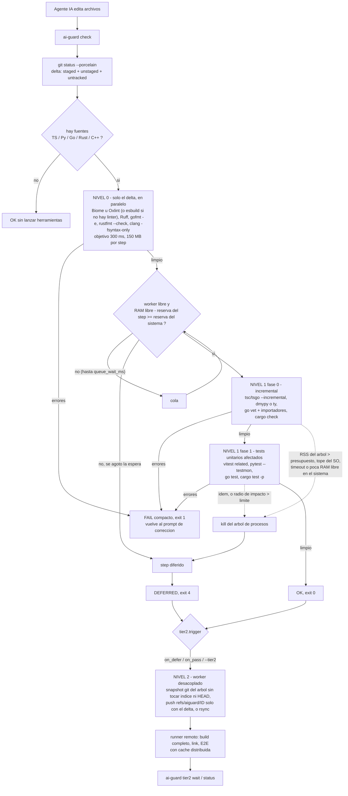

# AI-Guard

[English](README.md) · **Español**

[](https://github.com/AgustinBouzonn/ai-guard/actions/workflows/ci.yml)

Validación por niveles para código escrito por agentes de IA: feedback en milisegundos sobre el delta,
checks incrementales con RAM acotada alrededor del delta, y todo lo pesado fuera de la máquina.

## El problema

Un agente que edita código tiene que enterarse rápido de si la edición está rota. Lo habitual es correr
los comandos del propio repositorio (`eslint .`, `tsc --noEmit`, la suite de tests), que revisan el
proyecto entero en cada iteración. En el monorepo medido más abajo eso significa 12 segundos para
enterarse de un error de sintaxis, 44 segundos para uno de tipos y hasta 2,5 GB de RAM por un solo
type-check. Con varios agentes en una misma máquina, esas corridas de proyecto entero compiten por la
misma memoria.

## Qué hace

`ai-guard check` lee de git los archivos cambiados y los valida por niveles. Cada nivel arranca sólo si
el anterior no encontró nada.

| Nivel | Qué mira | Qué corre | Límite por step |
|---|---|---|---|
| **0** | sólo los archivos cambiados | lint y sintaxis, todos los lenguajes en paralelo | objetivo 300 ms, 150 MB |
| **1** | el delta y lo que toca | type-check incremental y después los tests unitarios afectados | objetivo 3 s, tope de RAM según la máquina |
| **2** | el árbol completo | build completo, integración y E2E, en un runner remoto o en segundo plano | fuera de la máquina de trabajo |

Cada herramienta corre contenida: un watchdog suma la memoria de todo su árbol de procesos y lo mata al
pasar el presupuesto, con un tope duro del sistema operativo por detrás. Un check que no entra no es un
error: se *difiere* al nivel 2.

Soporta TypeScript/JavaScript, Python, Go, Rust y C/C++, y es un único binario estático en Go, sin
dependencias, para Windows 11, Linux y WSL2.

Lo que vuelve al prompt del agente es compacto a propósito:

```
FAIL t0 99ms files=1 peak=31MB errors=2
src/bad.ts
  2:3 noDebugger This is an unexpected use of the debugger statement.
  3:12 noDoubleEquals Using == may be unsafe if you are relying on type coercion.

FAIL t0 13ms t1 864ms files=1 peak=118MB errors=1
test/calc.test.ts
  5:21 add AssertionError: expected -1 to be 4 // Object.is equality

OK t0 17ms t1 611ms files=1 peak=97MB
```

## Resultados

### En un proyecto real

El paquete de API de un monorepo pnpm privado (TypeScript 5.9, ESLint 9 con reglas con tipos, Vitest 5,
16 paquetes del workspace en un solo programa TypeScript). Notebook con Windows 11, 16 hilos y 32 GB,
con su trabajo normal encima. "Hoy" es lo que corre el repositorio: `pnpm typecheck`, `pnpm test:unit`,
`pnpm lint`. AI-Guard corrió sin configuración. Cada celda es tiempo / pico de RAM.

| Escenario | Hoy, máquina tranquila | AI-Guard, tranquila | Hoy, máquina cargada | AI-Guard, cargada |
|---|---:|---:|---:|---:|
| Error de sintaxis | — | **0,32 s** / 12 MB | 12,3 s / 646 MB | **0,57 s** / 12 MB |
| Error de tipos | — | **3,2 s** / 1,3 GB | 43,8 s / 2,3 GB | **5,0 s** / 1,4 GB |
| Cambio válido: sólo tipos | 29,4 s / 2,5 GB | **3,2 s** / 1,3 GB | 40,5 s / 2,5 GB | — |
| Cambio válido: tipos + tests unitarios | 52,9 s / 2,5 GB | **19,4 s** / 1,4 GB | 86,4 s / 2,5 GB | **34,4 s** / 1,4 GB |
| Cambio válido: lo anterior + lint | 105,4 s / 2,5 GB | **34,9 s** / ≤2,2 GB | 164,6 s / 2,5 GB | — |
| Árbol sin cambios | — | 0,20 s | — | 0,40 s |

- La ganancia grande está en los cambios rotos, que es donde el ciclo de un agente pasa su tiempo:
  unas 20 veces más rápido en un error de sintaxis y unas 9 veces en uno de tipos, con la misma carga.
- En un cambio válido la ganancia es de 2,5-3x, y el pico de RAM baja cerca de 45% con las cachés
  calientes.
- **Son corridas únicas, no medianas**, en una máquina en uso. Las celdas con "—" no se midieron.

### En un fixture sintético

3.025 archivos generados en cuatro lenguajes, sandbox Linux de 2 vCPU, medianas de dos corridas, contra
ESLint + tsc + Vitest, flake8 + black + pytest, `go build` + `go test`, `cargo build` + `cargo test`.
Medido con la versión 0.1.0.

| Lenguaje | Pipeline legacy | AI-Guard | Speedup (media geométrica) | Pico de RAM |
|---|---:|---:|---:|---:|
| TypeScript | 89,1 s | 19,0 s | **24,2x** | 503 → 195 MB |
| Python | 11,1 s | 2,9 s | **11,7x** | 74 → 65 MB |
| Go | 13,0 s | 2,6 s | **4,1x** | 123 → 110 MB |
| Rust | 1,5 s | 1,5 s | **1,0x** | 138 → 142 MB |

Los tiempos son la suma de cuatro parches por lenguaje (válido, error de sintaxis, error de tipos,
edición válida a un archivo que importa todo el resto). Donde la herramienta legacy ya es incremental
hay poco que ganar: en Rust no hay ganancia, y en errores de tipos de Go y Rust AI-Guard es 100-150 ms
*más lento*.

Tablas completas, números por step, el protocolo y cómo reproducirlo:
[docs/benchmarks.md](docs/benchmarks.md) (en inglés). Informes crudos: [`bench/results/`](bench/results).

### Contención, verificada en la máquina

`ai-guard selftest` lanza un proceso que pide 300 MB bajo un presupuesto de 64 MB y comprueba que muere.
En la misma notebook con Windows, al 83% de CPU:

```
PASS  memory watchdog (300 MB hog under a 64 MB budget: killed:mem after 133 ms at 68 MB)
PASS  timeout kills the whole tree (killed:timeout after 750 ms, grandchild 34380 gone=true)
PASS  OS hard cap (jobobject) (300 MB hog under a 64 MB cap, watchdog off: killed:mem after 93 ms)
```

## Inicio rápido

Compilarlo (Go 1.22 o posterior):

```
go install github.com/AgustinBouzonn/ai-guard/cmd/ai-guard@latest
```

o, desde un clon, `go build -o ai-guard ./cmd/ai-guard`.

Después, dentro de un repositorio git:

```
ai-guard selftest        prueba en esta máquina que un proceso fuera de presupuesto se mata
ai-guard doctor          RAM/CPU que ve el scheduler y qué herramienta correría en este repo
ai-guard tools install   baja el compilador nativo de TypeScript a una carpeta propia
ai-guard check           delta de git -> nivel 0 -> nivel 1 -> (nivel 2)
ai-guard run --mem MB --timeout S -- cmd...    cualquier comando, contenido
ai-guard hook            hook de Claude Code: valida el delta al terminar cada turno
```

Códigos de salida de `check`: `0` pasa, `1` hay errores en el código, `2` uso o config inválidos, `3`
un check no pudo completarse, `4` nada falló pero algo se difirió al nivel 2.

Para que un agente lo use, pegá [`configs/agents/AGENTS.snippet.md`](configs/agents/AGENTS.snippet.md)
en tu `AGENTS.md` o `CLAUDE.md`. Con Claude Code además se puede automatizar: `ai-guard hook` corre el
check al terminar cada turno y le devuelve los errores al agente (ver
[docs/usage.md](docs/usage.md#hook)). No hace falta archivo de configuración; `aiguard.json` sólo lleva
lo que difiere de los valores por defecto.

## Cómo funciona



Las ideas que sostienen el diseño:

- **Fail-fast.** El nivel 1 no arranca si el 0 encontró errores; los tests no corren si el análisis
  estático falló; el primer step que encuentra errores cancela a los demás.
- **La RAM se controla tres veces.** En la admisión (un step entra sólo si la máquina conserva su
  reserva), durante la ejecución (el watchdog y el tope del SO) y a nivel sistema (si la RAM libre baja
  demasiado, se detiene el step más pesado).
- **La herramienta más rápida que responde la pregunta.** Un parser para la sintaxis, un type-checker
  que no emite ni enlaza para la semántica, selección de tests por grafo de imports en vez de la suite
  completa. Ejecuta los binarios nativos directamente, no los shims de Node.
- **Lo que no entra se difiere, no falla.** El nivel 2 toma un snapshot del árbol de trabajo en una ref
  de git sin tocar tu índice ni HEAD, y un runner remoto hace la parte pesada.
- **Nada ensucia el repositorio.** Todo el estado vive en una carpeta `.aiguard/` que se auto-ignora, y
  git se lee sin tomar el lock del índice.

## Documentación

La documentación técnica está en inglés.

| | |
|---|---|
| [docs/architecture.md](docs/architecture.md) | flujo, decisiones de diseño, límites de recursos por sistema operativo, estructura del código, resultados de los tests |
| [docs/usage.md](docs/usage.md) | todos los comandos y flags, formato de salida, códigos de salida, referencia de `aiguard.json` |
| [docs/tooling.md](docs/tooling.md) | qué herramienta reemplaza a cuál, los comandos exactos y las configuraciones drop-in de `configs/` |
| [docs/benchmarks.md](docs/benchmarks.md) | protocolo, resultados completos, cómo leerlos y cómo reproducirlos |
| [docs/limitations.md](docs/limitations.md) | lo que no se verificó y los límites conocidos |
| [CHANGELOG.md](CHANGELOG.md) | qué cambió en cada versión |

## Estado y límites

Versión 0.3.0. Los límites principales:

- Los números del proyecto real salen de un paquete de un repositorio, con corridas únicas.
- En macOS sólo compila: no tiene watchdog de RSS ni admisión por RAM.
- La plantilla del workflow de GitHub para el nivel 2 pasa `actionlint` pero no se ejecutó en GitHub.
- En una máquina de 8 GB, un type-check que necesita 2,3 GB en frío se mata y se difiere; hace falta un
  override o el nivel 2.

La lista completa está en [docs/limitations.md](docs/limitations.md).

## Desarrollo

```
go vet ./...
go test ./...
```

Los tests usan procesos reales: el propio binario de test hace de proceso que consume memoria, de
herramienta falsa y de worker del nivel 2, y git real provee el delta. El 2026-11-10 esta revisión pasó
218 tests en Windows 11 (Go 1.27.3) y 219 en Linux (Go 1.23.12, 3 omitidos porque el contenedor no
tiene Node, Python ni un cgroup escribible).

## Licencia

Copyright (c) 2026 Agustin Bouzon. Todos los derechos reservados.

El código se publica para ser leído. No se otorga licencia para usarlo, copiarlo, modificarlo ni
distribuirlo; ver [LICENSE](LICENSE). Para pedir permiso, abrí un issue.
