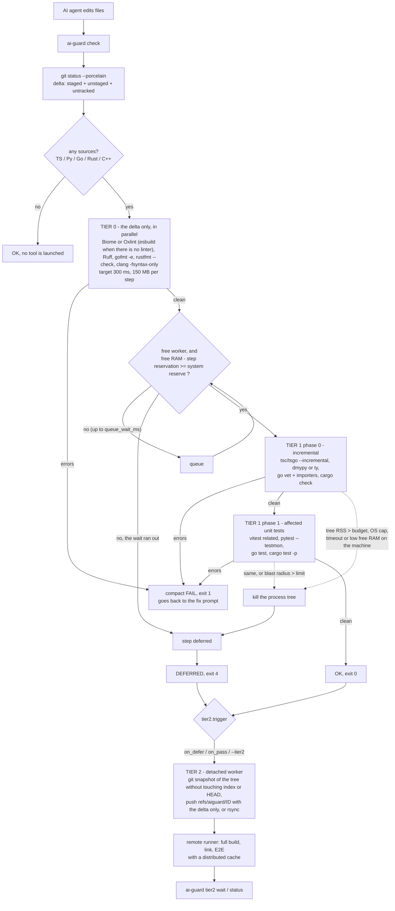

# AI-Guard

**English** · [Español](README.es.md)

[](https://github.com/AgustinBouzonn/ai-guard/actions/workflows/ci.yml)

Tiered validation for code written by AI agents: feedback in milliseconds on the delta, incremental
checks with bounded RAM around it, and everything heavy off the machine.

## The problem

An agent that edits code has to find out quickly whether the edit is broken. The usual way is to run
the repository's own commands (`eslint .`, `tsc --noEmit`, the test suite), which check the whole
project on every iteration. In the monorepo measured below, that means 12 seconds to learn about a
syntax error, 44 seconds for a type error, and up to 2.5 GB of RAM for one type-check. With several
agents on one workstation, those whole-project runs compete for the same memory.

## What it does

`ai-guard check` reads the changed files from git and validates them in tiers. Each tier only starts if
the one before it found nothing.

| Tier | Looks at | Runs | Envelope per step |
|---|---|---|---|
| **0** | the changed files only | lint and syntax, every language in parallel | target 300 ms, 150 MB |
| **1** | the delta and what it touches | incremental type-check, then the affected unit tests | target 3 s, RAM cap sized from the machine |
| **2** | the whole tree | full build, integration and E2E, on a remote runner or in the background | off the workstation |

Every tool runs contained: a watchdog adds up the memory of its whole process tree and kills it past
the budget, with an OS-level hard cap behind it. A check that does not fit is not an error: it is
*deferred* to tier 2.

It supports TypeScript/JavaScript, Python, Go, Rust and C/C++, and it is one static Go binary with no
dependencies, for Windows 11, Linux and WSL2.

What goes back to the agent's prompt is compact on purpose:

```
FAIL t0 99ms files=1 peak=31MB errors=2
src/bad.ts
  2:3 noDebugger This is an unexpected use of the debugger statement.
  3:12 noDoubleEquals Using == may be unsafe if you are relying on type coercion.

FAIL t0 13ms t1 864ms files=1 peak=118MB errors=1
test/calc.test.ts
  5:21 add AssertionError: expected -1 to be 4 // Object.is equality

OK t0 17ms t1 611ms files=1 peak=97MB
```

## Results

### On a real project

The API package of a private pnpm monorepo (TypeScript 5.9, ESLint 9 with typed rules, Vitest 5, 16
workspace packages in one TypeScript program). Windows 11 laptop, 16 logical cores, 32 GB, with its
normal work running. "Today" is what the repository runs: `pnpm typecheck`, `pnpm test:unit`,
`pnpm lint`. AI-Guard ran with no configuration. Each cell is time / peak RAM.

| Scenario | Today, quiet machine | AI-Guard, quiet | Today, loaded machine | AI-Guard, loaded |
|---|---:|---:|---:|---:|
| Syntax error | — | **0.32 s** / 12 MB | 12.3 s / 646 MB | **0.57 s** / 12 MB |
| Type error | — | **3.2 s** / 1.3 GB | 43.8 s / 2.3 GB | **5.0 s** / 1.4 GB |
| Valid change: types only | 29.4 s / 2.5 GB | **3.2 s** / 1.3 GB | 40.5 s / 2.5 GB | — |
| Valid change: types + unit tests | 52.9 s / 2.5 GB | **19.4 s** / 1.4 GB | 86.4 s / 2.5 GB | **34.4 s** / 1.4 GB |
| Valid change: the above + lint | 105.4 s / 2.5 GB | **34.9 s** / ≤2.2 GB | 164.6 s / 2.5 GB | — |
| Unchanged tree | — | 0.20 s | — | 0.40 s |

- The large gain is on broken changes, which is where an agent's loop spends its time: about 20x
  faster on a syntax error and about 9x on a type error, under the same load.
- On a valid change the gain is 2.5-3x, and peak RAM drops about 45% when caches are warm.
- **These are single runs, not medians**, on a machine in use. Cells marked "—" were not measured.

### On a synthetic fixture

3,025 generated files in four languages, Linux sandbox with 2 vCPUs, medians of two runs, against
ESLint + tsc + Vitest, flake8 + black + pytest, `go build` + `go test`, `cargo build` + `cargo test`.
Measured with version 0.1.0.

| Language | Legacy pipeline | AI-Guard | Speedup (geometric mean) | Peak RAM |
|---|---:|---:|---:|---:|
| TypeScript | 89.1 s | 19.0 s | **24.2x** | 503 → 195 MB |
| Python | 11.1 s | 2.9 s | **11.7x** | 74 → 65 MB |
| Go | 13.0 s | 2.6 s | **4.1x** | 123 → 110 MB |
| Rust | 1.5 s | 1.5 s | **1.0x** | 138 → 142 MB |

Times are the sum of four patches per language (valid, syntax error, type error, valid edit to a file
everything imports). Where the legacy tool is already incremental there is little to win: no gain in
Rust, and on Go and Rust type errors AI-Guard is 100-150 ms *slower*.

Full tables, per-step numbers, the protocol and how to reproduce it:
[docs/benchmarks.md](docs/benchmarks.md). Raw reports: [`bench/results/`](bench/results).

### Containment, verified on the machine

`ai-guard selftest` starts a process that allocates 300 MB under a 64 MB budget and checks that it
dies. On the same Windows laptop, at 83% CPU:

```
PASS  memory watchdog (300 MB hog under a 64 MB budget: killed:mem after 133 ms at 68 MB)
PASS  timeout kills the whole tree (killed:timeout after 750 ms, grandchild 34380 gone=true)
PASS  OS hard cap (jobobject) (300 MB hog under a 64 MB cap, watchdog off: killed:mem after 93 ms)
```

## Quick start

Build it (Go 1.22 or newer):

```
go install github.com/AgustinBouzonn/ai-guard/cmd/ai-guard@latest
```

or, from a clone, `go build -o ai-guard ./cmd/ai-guard`.

Then, inside a git repository:

```
ai-guard selftest        prove on this machine that an over-budget process is killed
ai-guard doctor          RAM/CPU the scheduler sees, and which tool would run in this repo
ai-guard tools install   download the native TypeScript compiler into its own directory
ai-guard check           git delta -> tier 0 -> tier 1 -> (tier 2)
ai-guard run --mem MB --timeout S -- cmd...    run any command contained
ai-guard hook            Claude Code hook: check the delta when a turn ends
```

Exit status of `check`: `0` pass, `1` errors in the code, `2` usage or config error, `3` a check could
not complete, `4` nothing failed but something was deferred to tier 2.

To make an agent use it, paste [`configs/agents/AGENTS.snippet.md`](configs/agents/AGENTS.snippet.md)
into your `AGENTS.md` or `CLAUDE.md`. With Claude Code you can also make it automatic: `ai-guard hook`
runs the check when a turn ends and hands the errors back to the agent (see
[docs/usage.md](docs/usage.md#hook)). No configuration file is needed; `aiguard.json` only holds what
differs from the defaults.

## How it works



The ideas that carry the design:

- **Fail fast.** Tier 1 does not start if tier 0 found errors; tests do not run if static analysis
  failed; the first step that finds errors cancels the others.
- **RAM is controlled three times.** At admission (a step enters only if the machine keeps its
  reserve), during execution (the watchdog and the OS cap), and system-wide (if free RAM gets low, the
  heaviest step is stopped).
- **Use the fastest tool that answers the question.** A parser for syntax, a type-checker that neither
  emits nor links for semantics, test selection by import graph instead of the whole suite. It runs the
  native binaries directly, not the Node shims.
- **What does not fit is deferred, not failed.** Tier 2 snapshots the working tree into a git ref
  without touching your index or HEAD, and a remote runner does the heavy part.
- **Nothing dirties the repository.** All state lives in a self-ignoring `.aiguard/` directory, and git
  is read without taking its index lock.

## Documentation

| | |
|---|---|
| [docs/architecture.md](docs/architecture.md) | flow, design decisions, resource limits per OS, code layout, test results |
| [docs/usage.md](docs/usage.md) | every command and flag, output format, exit codes, `aiguard.json` reference |
| [docs/tooling.md](docs/tooling.md) | which tool replaces which, the exact commands, and the drop-in configs in `configs/` |
| [docs/benchmarks.md](docs/benchmarks.md) | protocol, full results, how to read them, how to reproduce them |
| [docs/limitations.md](docs/limitations.md) | what was not verified, and the known limits |
| [CHANGELOG.md](CHANGELOG.md) | what changed in each version |

## Status and limits

Version 0.3.0. The main limits:

- The real-project numbers come from one package of one repository, single runs.
- macOS only compiles: it has no RSS watchdog and no RAM admission.
- The tier-2 GitHub workflow template passes `actionlint` but has not been executed on GitHub.
- On a machine with 8 GB, a type-check that needs 2.3 GB cold is killed and deferred; it needs an
  override or tier 2.

The complete list is in [docs/limitations.md](docs/limitations.md).

## Development

```
go vet ./...
go test ./...
```

The tests use real processes: the test binary itself plays the memory hog, the fake tool and the tier-2
worker, and real git provides the delta. On 2026-11-10 this revision passed 218 tests on Windows 11
(Go 1.27.3) and 219 on Linux (Go 1.23.12, 3 skipped for lack of Node, Python and a writable cgroup in
the container).

## License

Copyright (c) 2026 Agustin Bouzon. All rights reserved.

The source is published to be read. No license is granted to use, copy, modify or distribute it; see
[LICENSE](LICENSE). To ask for permission, open an issue.
