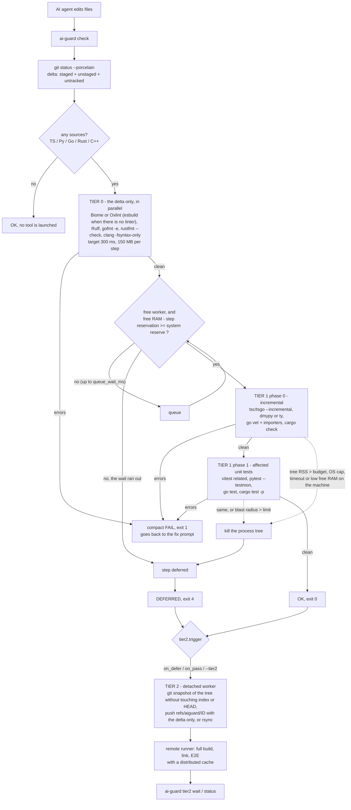

# Architecture

AI-Guard answers one question after an AI agent edits files: *is this change broken?* It answers it
in tiers, so the cheap answer comes first and the expensive one never runs on the workstation.

| Tier | Looks at | Runs | Envelope per step |
|---|---|---|---|
| 0 | the changed files only | lint and syntax, every language in parallel | target 300 ms, 150 MB |
| 1, phase 0 | the delta and what it touches | incremental type-check / static analysis | target 3 s, RAM cap sized from the machine |
| 1, phase 1 | tests affected by the delta | unit tests only | same |
| 2 | the whole tree | full build, link, integration and E2E, on another machine or in the background | whatever the remote has |

## Flow



The diagram source is [`architecture.mmd`](architecture.mmd).

## Design decisions

**Fail fast, for real.** Tier 1 does not start if tier 0 found errors. Inside tier 1, tests do not run
if static analysis failed. The first step that finds errors cancels the others.

**RAM is controlled in three places.**

- *Admission.* A step is admitted only if, after subtracting its reservation (and whatever the steps
  already admitted have not occupied yet), the machine keeps the system reserve: 1/16 of installed RAM,
  between 256 MB and 2 GB.
- *Execution.* A watchdog adds up the RSS of the whole process tree every 3-50 ms and kills it past the
  cap. In tier 1 there is also a hard OS cap at 1.5x.
- *System.* If free RAM drops below half the reserve, whoever caused it, the step holding the most
  memory is stopped.

**Cap and reservation are different numbers.** With `tier1.mem_mb: 0` (the default) the cap of a step is
RAM/8, between 1 and 4 GB, and its reservation is 1.25x the median of its last 8 runs (half the cap if
it never ran). The cap does not shrink with history: a cold type-check uses 2.3 GB and a warm one
0.5-1.3 GB, so a cap learned from warm runs would kill the cold one. With an explicit `mem_mb`, cap and
reservation are both that number.

**What does not fit is deferred.** No RAM after `queue_wait_ms`, killed for budget, over time in tier 1,
or a blast radius that is too wide: none of these is an error. The step is `DEFERRED` and, depending on
`tier2.trigger`, queued remotely. There is no mid-run pause (SIGSTOP): a paused process does not give
its RSS back, so the "pause" is the admission queue.

**The wait for RAM is spent once per run.** `queue_wait_ms` is one allowance for the whole of tier 1,
not one per phase. Once static analysis has waited it out, the machine is full: the tests get a single
attempt and are deferred at once if they still do not fit. A step that does fit still runs.

**Tools are told the limit, they do not just hit it.** Node gets `--max-old-space-size` at 75% of the
cap. Go binaries (the native TypeScript compiler) get `GOMEMLIMIT` at 90%. Threads per tool = idle cores
/ steps running at once in that phase (`GOMAXPROCS`, `--checkers`, `CARGO_BUILD_JOBS`, `GOFLAGS=-p`,
`--maxWorkers`), with a floor of 1/4 of the cores: tier 1 runs at low priority, so on a busy machine the
OS takes those cores back as soon as another process asks for them.

**No shims.** Biome and the native TypeScript compiler are executed from the platform package inside
`node_modules` (also in the pnpm store). JavaScript CLIs run as `node <entry>`, not through `.bin/*.cmd`.

**Daemons count.** The memory of the `dmypy` server is added to the step that uses it and has its own
ceiling (`python.daemon_max_rss_mb`); past it, the daemon is restarted.

**Nothing dirties the repository.** All state lives in `.aiguard/`, which ignores itself with its own
`.gitignore`: tsbuildinfo, ruff and mypy caches, the testmon database, per-step statistics, tier-2 logs.
The delta is read with `git --no-optional-locks status`, which neither rewrites `.git/index` nor
competes for its lock with the editor or another agent. Tools that AI-Guard brings itself go to their
own directory (`AIGUARD_TOOLS`, `tools/` next to the binary, or the user cache), never into the
project's `node_modules`.

**Tier 2 never starts by itself.** Without a `tier2.command` or a configured `tier2.trigger`, `--tier2`
refuses to run: the defaults never push the working tree to a remote.

## Tier 2

`ai-guard` creates a commit of the working tree using a private index, so your index, HEAD and files are
untouched. It pushes that commit to `refs/aiguard/<id>` (only new objects travel) and runs
`tier2.command` with `{id} {sha} {ref} {branch} {root}` expanded. A detached process does the work:
`check` returns immediately with `> tier2 queued id=...`, and you follow the job with
`ai-guard tier2 wait|status|list`.

Sync modes: `git-ref`, `rsync`, and `none` (for a continuous sync such as mutagen, or for a job that
runs on the same machine).

Two templates are provided in [`configs/tier2/`](../configs/tier2): a GitHub Actions workflow and a
shell worker for a build box reached over SSH.

## Resource limits per operating system

| | Windows | Linux / WSL2 | macOS |
|---|---|---|---|
| Process tree | Job Object (the process starts suspended, joins the job, and only then runs) | process group + descendants (`/proc`) | process group |
| Watchdog | private working set of every process in the job + shared memory counted once | private RSS of every process + shared memory counted once | none |
| Hard cap | job memory limit; a tree pinned at the limit is killed | delegated cgroup v2 or writable v1; optional `RLIMIT_AS` | none |
| Free RAM | min(available physical, remaining commit) | `MemAvailable` | none (no RAM admission) |
| Verified | native test binaries, `selftest`, and real checks (esbuild, tsgo, Vitest, ESLint) on Windows 11 build 26200 | tests, `-race`, `selftest` (cgroup v1) and real checks | compiles only |

`ai-guard selftest` proves the containment on the machine it runs on. Output on a Windows 11 laptop
(16 logical cores, 32 GB) on 2026-11-10, while the machine was at 83% CPU:

```
PASS  free RAM readable (6207 of 32093 MB available)
PASS  CPU load readable (83% busy)
PASS  memory watchdog (300 MB hog under a 64 MB budget: killed:mem after 133 ms at 68 MB)
PASS  timeout kills the whole tree (killed:timeout after 750 ms, grandchild 34380 gone=true)
PASS  OS hard cap (jobobject) (300 MB hog under a 64 MB cap, watchdog off: killed:mem after 93 ms)
```

## Code layout

One static Go binary with no dependencies outside the standard library: about 8,500 lines plus 5,000
lines of tests.

```
cmd/ai-guard        check, run, hook, doctor, tools, selftest, init, tier2, bench
internal/gitx       delta: git status --porcelain -z (staged, unstaged, untracked), --staged, --since
internal/lang       classification by extension and project root (FindUp)
internal/tools      plan: which tool, with which flags, in which directory, for each group of files;
                    memoised PATH lookup (its directories are listed once)
internal/sysres     available RAM and CPU load (Linux /proc, Windows GlobalMemoryStatusEx/GetSystemTimes)
internal/sched      semaphore with RAM admission
internal/stats      peak RSS and duration of the last 8 runs of each step
internal/runner     contained process tree: RSS watchdog, OS cap, timeout, kill, metrics
internal/pipeline   tier 0 -> tier 1 (phases) -> tier-2 policy; cap and reservation of each step
internal/diag       parsers: Biome, Oxlint, esbuild, ESLint, tsc/MSVC, Ruff, gcc/clang/cargo/mypy/ty, go,
                    go test -json, pytest, vitest, jest, pyright, rustc
internal/report     compact output for the agent, and JSON
internal/remote     git snapshot, push/rsync, remote command, job status
internal/bench      simulated patches, measurement, table
```

## Tests

`go test ./...` uses real processes: the test binary itself plays the memory hog, the fake tool and the
tier-2 worker; real git provides the delta and tier 2; a fake `npm` stands in for `tools install`.

Results on 2026-11-10 for this revision:

| Platform | Go | Result |
|---|---|---|
| Windows 11 (build 26200), amd64 | 1.27.3 | 218 tests pass, `go vet` clean |
| Linux amd64 (Alpine container) | 1.23.12 | 219 pass, 3 skipped, `go vet` clean |

The three skips on Linux come from the container, not from the code: it has no Node, no Python and no
writable memory cgroup, which those tests need. CI also runs the suite under the race detector on
Linux.
